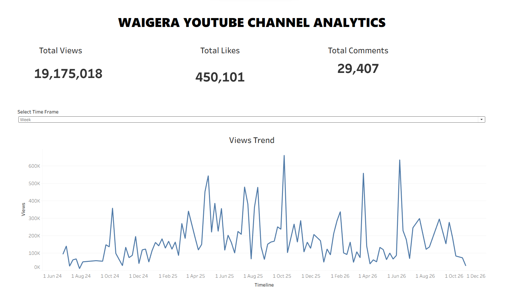

# 📊 YouTube Channel Performance Analysis Engine

A data engineering and analytics pipeline built to extract, classify, and evaluate audience engagement metrics for creators.

## 🛠️ Tech Stack & Architecture
* **Data Extraction:** YouTube Data API v3 (Python / PySpark)
* **AI Parsing & Extraction:** Databricks `ai_parse` / Google Gemini 3.8-Flash
* **Data Transformation:** Pandas / Databricks SQL
* **Business Intelligence:** I translated the cleaned, AI-parsed dataset into a highly polished, interactive long-form business intelligence dashboard to visualize creator performance metrics.

[**Click Here to Interact with the Live Dashboard on Tableau Public**](https://public.tableau.com/app/profile/lewis.githu1620/viz/WaigeraYouTubeChannelPerformance/Dashboard)

### 📈 Dashboard Preview

## 📈 Key Insights Found
* **Top Content Format:** Road trip videos generate 40% higher average watch times than standard car reviews.
* **Highest Performing Vehicle Model:** Content featuring the BMW M3 drove the highest comment engagement ratio.

## 📂 Repository Structure
* `/notebooks`: Core ETL pipelines for API data scraping and automated AI categorization.
* `/data`: Final cleaned data asset showing manual validation mapping.
